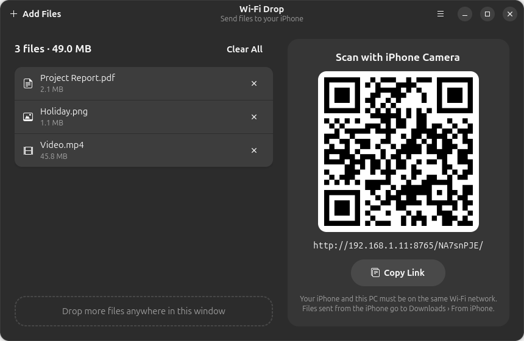

<p align="center">
  
</p>

<p align="center">
  <a href="https://snapcraft.io/wifi-drop"></a>
</p>

**Wi-Fi Drop** sends files from Ubuntu (or any Linux desktop) to an iPhone over your Wi-Fi network,
AirDrop-style. Nothing to install on the phone — the iPhone camera and Safari are all you need.

<p align="center">
  
</p>

## Install

```bash
sudo snap install wifi-drop
```

## How to use

1. Open **Wi-Fi Drop** and drag files onto the window — PDFs, photos, videos, anything.
2. Scan the QR code with your iPhone camera. Safari opens with your files.
3. Tap **Save** to put a file in the Files app, or **Open** → Share → *Save Image / Save Video* for Photos.

- Drop more files while the page is open — the iPhone page updates by itself.
- **Download all as ZIP** grabs everything at once.
- It works both ways: tap **Choose…** on the iPhone to send photos and files to the PC
  (saved in `~/Downloads/From iPhone`).
- Terminal mode: `wifi-drop --cli FILE...` prints the QR code in the terminal.

## Privacy

Files are served only on your local network, directly from your PC — nothing is uploaded to the
internet. Each session uses a random secret link, so other devices on the same network can't browse
your files without scanning the QR code.

## Why not real AirDrop?

AirDrop uses Apple's AWDL protocol, which needs special Wi-Fi hardware support that almost no Linux
Wi-Fi drivers provide. Wi-Fi Drop uses plain Wi-Fi + a web page, so it works on any PC.

## Troubleshooting

- **The iPhone can't open the page:** both devices must be on the same Wi-Fi. Public/café Wi-Fi often
  blocks device-to-device traffic — turn on the iPhone's Personal Hotspot and connect the PC to it.
- **Firewall enabled:** `sudo ufw allow 8765/tcp`.
- **Sharing files from USB drives:** `sudo snap connect wifi-drop:removable-media`.

## Development

```bash
src/wifi-drop                # run the GUI from source (needs python3-gi, gir1.2-adw-1, python3-qrcode)
src/wifi-drop --cli FILE...  # terminal mode
snapcraft pack               # build the snap (uses LXD)
```

| Path | What it is |
|------|------------|
| `src/wifidrop/server.py` | HTTP server: secret per-session link, range requests, ZIP download, uploads |
| `src/wifidrop/gui.py` | GTK4 / libadwaita window with drag-and-drop and QR code |
| `src/wifidrop/cli.py` | Terminal mode |
| `snap/` | snapcraft recipe, desktop entry and app icon |
| `data/` | Logo PNGs, banner and screenshot |

## License

[MIT](LICENSE)
